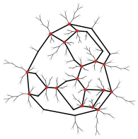
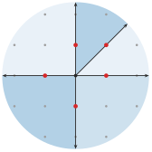
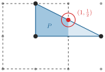
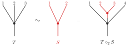

I work in polyhedral geometry, at the crossroads of combinatorics, topology and algebra.

- **Combinatorics:** simplicial complexes, (delta-)matroids, graphs
- **Geometry:** polytopes, polyhedral fans, PL spheres, tropical varieties
- **Topology:** polyhedral products, moment-angle complexes, (topological) toric manifolds
- **Linear algebra:** $0/\pm1$-matrices, totally unimodular and totally equimodular matrices
- **Algebra:** Stanley–Reisner rings, Chow rings, algebraic groups, operads

#### Tropical geometry

**Mukai Grassmannians and Mukai's model for curves, tropically.** Tropicalization turns an algebraic variety into a polyhedral complex that retains much of its geometry. We study the tropicalization of Mukai Grassmannians.

*Ongoing:* with [Michael Joswig](https://page.math.tu-berlin.de/~joswig/), [Kevin Kuehn](https://page.math.tu-berlin.de/~kuehn/), [Bernd Sturmfels](https://math.berkeley.edu/~bernd/).

<figure class="research-fig">
  
  <figcaption>The Berkovich skeleton of a genus 10 curve, with its trivalent vertices in red.</figcaption>
</figure>

#### Toric topology

**Toric manifolds of small Picard number.** Toric manifolds correspond to complete nonsingular fans, and their Picard number is the number of rays minus the dimension. We use the wedge operation on simplicial complexes to classify PL spheres and toric manifolds of small Picard number.

[[slides](toric.pdf)] — *with [Suyoung Choi](https://schoimath.github.io), [Hyeontae Jang](https://sites.google.com/ajou.ac.kr/hyeontae1112)*

*Ongoing:* enumeration of PL spheres and toric manifolds of small Picard number, with [Suyoung Choi](https://schoimath.github.io).

<figure class="research-fig">
  
  <figcaption>A complete nonsingular fan in $\mathbb{R}^2$ with five rays, the fan of a toric surface of Picard number $3$.</figcaption>
</figure>

#### Combinatorial optimization

**Box-integrality and integer decomposition.** A polyhedron is box-integral if it stays integral after intersecting it with any integer box. I study the integer decomposition properties of such polyhedra via triangulations, box-total dual integrality, and totally equimodular (TE) matrices, a generalization of totally unimodular matrices.

[[slides](TE.pdf), [poster](poster.pdf)] — *with Patrick Chervet, [Roland Grappe](https://www.lamsade.dauphine.fr/~rgrappe/index.html)*

*Ongoing:* recognition and characterization of TE matrices, with [Roland Grappe](https://www.lamsade.dauphine.fr/~rgrappe/index.html).

<figure class="research-fig">
  
  <figcaption>The integer triangle $P$ meets the box $[-1,1]^2$ in a polygon with the non-integral vertex $(1,\tfrac12)$: $P$ is not box-integral.</figcaption>
</figure>

#### Operad theory

**Set-theoretic operads.** Operads encode the operations acting on a category of algebras. I study operads on sets, in particular on simplicial complexes, and their action on polyhedral products, which give topological models for toric manifolds.

[[slides](operads.pdf)]

<figure class="research-fig">
  
  <figcaption>The partial composition $T \circ_2 S$ grafts the root of $S$ onto the second leaf of $T$.</figcaption>
</figure>

### Ph.D. thesis
  - **Title:** *Cones, fans, and wedges: combinatorial and geometrical perspectives*
  - **Date defended:** 9 September 2025
  - **Institution:** [LIPN](https://lipn.univ-paris13.fr/) (Laboratoire d’Informatique de Paris Nord), [Université Sorbonne Paris Nord](https://www.univ-spn.fr/), France
  - **Advisors:** [Roland Grappe](https://www.lamsade.dauphine.fr/~rgrappe/index.html) and [Bruno Vallette](https://www.math.univ-paris13.fr/~vallette/)
  - **Topics:** combinatorial optimization, polyhedral geometry, toric geometry
  - **Manuscript:** [PDF](manuscrit_thèse.pdf)
